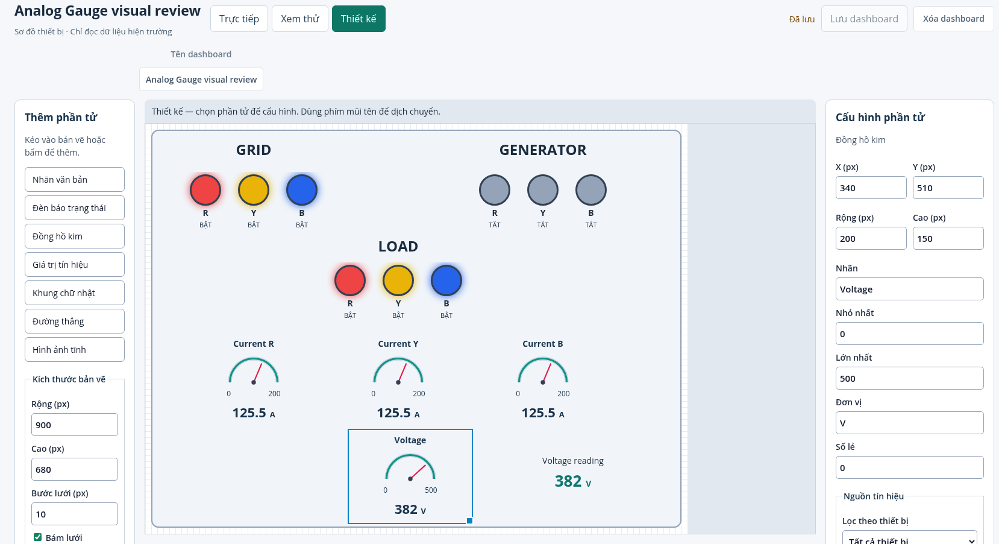
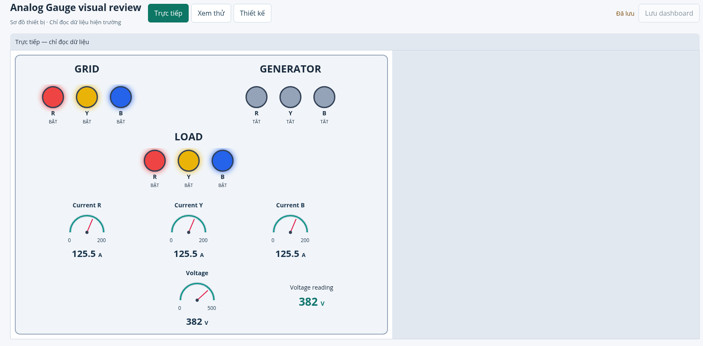
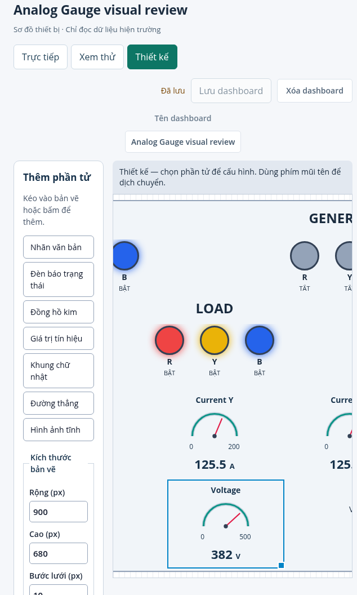
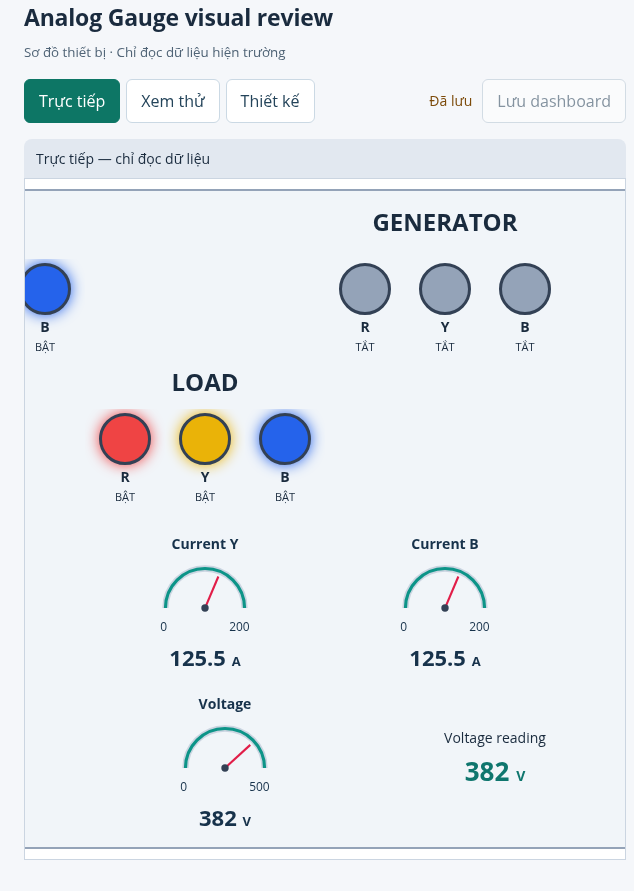

# Analog Gauge — sửa layout và ảnh review

Nguyên nhân: nhãn, SVG có kích thước nội tại và giá trị dùng chung flex column; SVG co giãn không có hàng riêng để giới hạn vùng vẽ. Khi control thấp, mặt đồng hồ tiến sát nhãn. Nhãn và giá trị cũng không có vùng bảo vệ độc lập.

Bản sửa trong ControlRenderer.tsx và analogGauge.css:

- Ba hàng grid riêng cho nhãn, mặt đồng hồ và giá trị/đơn vị. Các vùng có giới hạn và overflow riêng.
- SVG giữ tỷ lệ, có khoảng đệm phía trên cung. Min/max nằm trong hàng riêng dưới SVG, căn theo chiều rộng mặt đồng hồ.
- Khi rộng dưới 130 px hoặc cao dưới 140 px, ẩn mặt kim/thang đo và ưu tiên nhãn với giá trị. Dưới 72 px rộng hoặc 64 px cao, dùng chữ nhỏ và ellipsis. Trạng thái không khả dụng vẫn là dấu gạch, có lý do qua tooltip; không biến thành 0.
- Không đổi default height, binding, dữ liệu Preview/Live hoặc cấu hình đã lưu.

Kiểm tra: regression cấu trúc đã thất bại trên bản cũ rồi qua trên bản sửa; toàn bộ 150 kiểm thử Web qua. Chromium đo vùng nhãn/SVG/giá trị ở 7 kích thước: 50×40, 120×90, 150×120, 220×170, 400×200, 180×360 và 320×80. Kiểm tra cả nội dung trạng thái không khả dụng, hình học Preview/Live giống nhau và viewport 1900 / 720 px. Build và TypeScript lint qua.

Ảnh dưới là fixture GRID / GENERATOR / LOAD trong stack preview, dùng dữ liệu simulator qua Core. Ảnh cắt vào vùng làm việc để tập trung vào gauge. Canvas ở màn hình hẹp vẫn cuộn ngang; ảnh Design hẹp cuộn đến Voltage để thấy rõ nhãn và giá trị.

## Design — desktop

## Live — desktop

## Design — narrow

## Live — narrow

