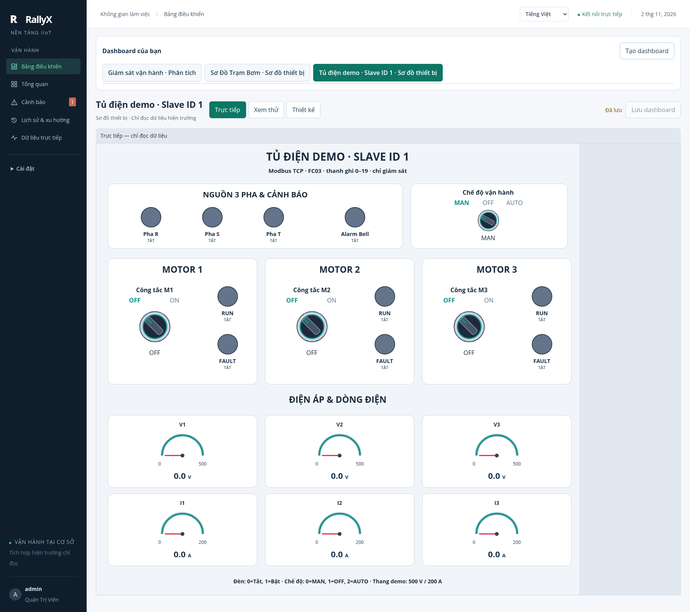
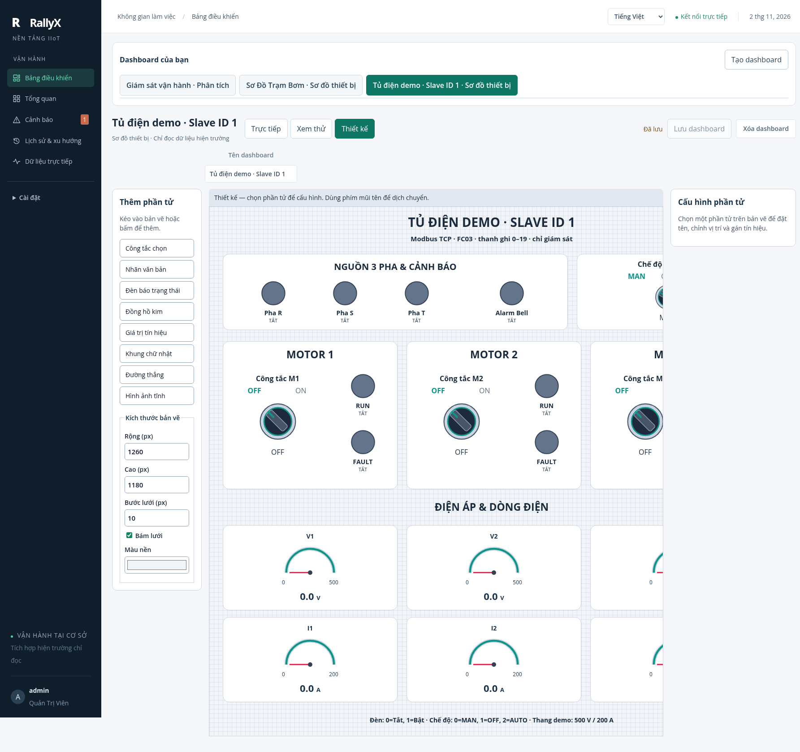

# Indicator lamp clipping fix

The original centered flex column exceeded a 105px control by 3.8–5.6px. Browser measurements placed the circle 1.9–2.8px above the control, where overflow clipped its upper edge. This affected the shared lamp renderer, including the Slave ID 1 motor lamps.

The renderer now reserves separate drawing, label and status rows. A padded SVG preserves the circle aspect ratio within the available drawing area. Compact controls hide the status; minimal controls show only the drawing and retain the tooltip. Default dimensions, saved layouts, bindings and field data are unchanged.

Verification: new structure regression failed before the fix and passed afterward; 171 Web tests pass; TypeScript and production build pass. Browser regression `tests/e2e/indicator-lamp-layout.test.mjs` covers seven sizes, ON/OFF/unavailable, Design/Preview/Live and a 720px viewport. It checks circular geometry, drawing containment and separate text rows. Operating rollout retains 24 tags, 3 devices, 5 legacy widgets and the original board; all 24 tags GOOD at verification.

## Live — actual Slave ID 1 panel

## Design — actual Slave ID 1 panel

