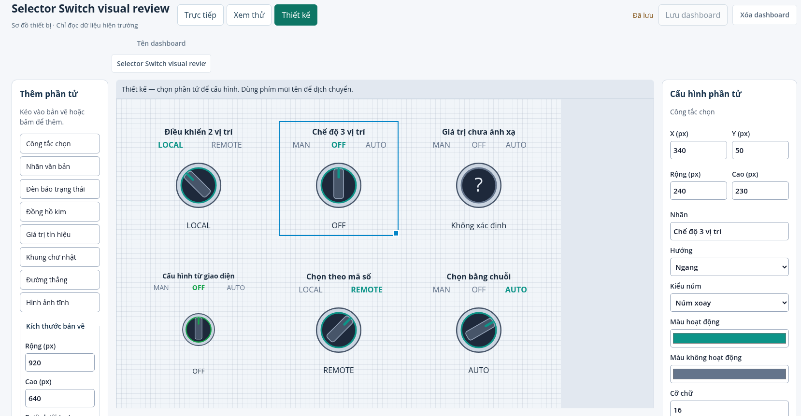
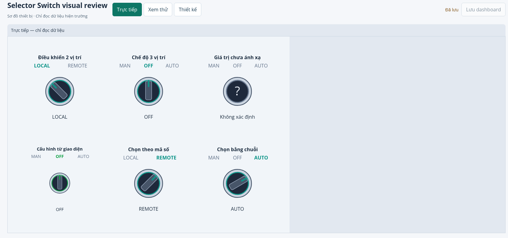
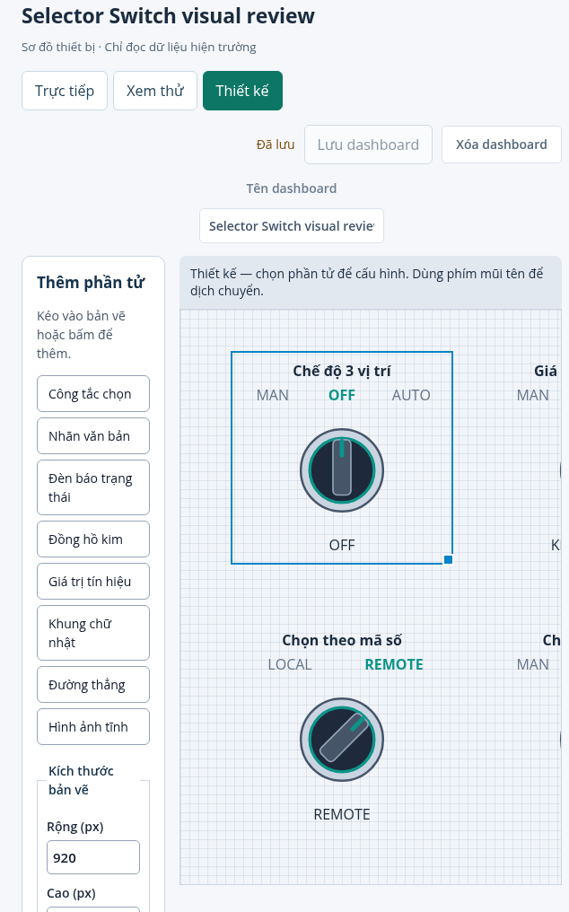
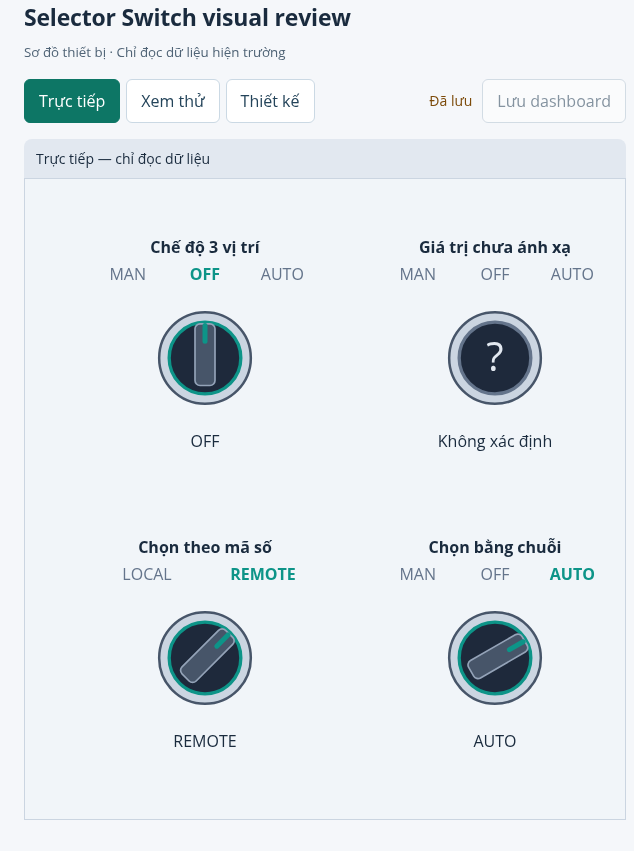

# Selector Switch visual review

Fixture tạo qua API trên stack preview riêng, không ghi cứng vào sản phẩm: boolean LOCAL/REMOTE, số MAN/OFF/AUTO = 10/20/30, số 99 chưa ánh xạ, số hai vị trí, chuỗi ba vị trí và một control tạo hoàn toàn bằng Properties.

Kiểm chứng: 170 Web tests; chạy lại 20 selector/Properties tests sau chỉnh bảng dữ liệu test; TypeScript lint và production build; full Core suite với PostgreSQL/MQTT thật. Browser acceptance `tests/e2e/selector-switch.test.mjs` xác nhận thay đổi dữ liệu simulator qua Core, Preview không mutation, click Live không phát request, mất WebSocket với giá trị GOOD đã cache, thiếu nguồn, reconnect, lưu/reload/new tab và viewport 720px. Không thử ghi lệnh thiết bị.

## Design desktop

## Live desktop

## Design narrow

Canvas giữ kích thước thiết kế và cuộn nội bộ; ảnh cuộn đến công tắc ba vị trí và trạng thái không xác định.

## Live narrow

